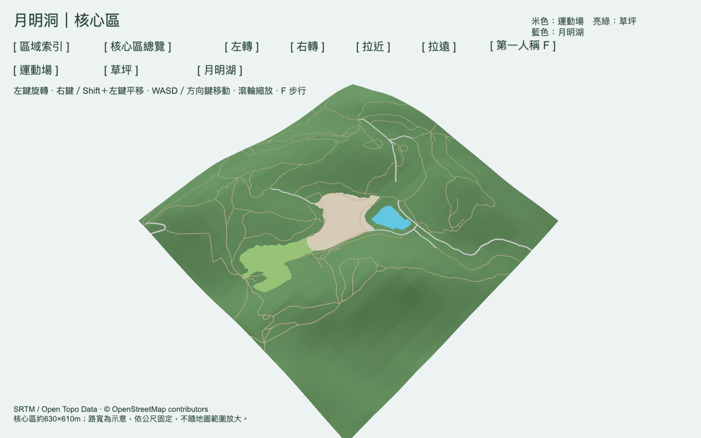

# 月明洞｜核心區地形與步行

GDevelop 原生可雕刻、可塗色的 3D Terrain 專案。現在優先製作約 **629 × 612 公尺**的核心區，包含月明湖、運動場、草坪及周邊步道；原先約 3.56 × 4.40 公里的範圍保留為「區域索引」，供之後分區擴充。

## 開啟

在 GDevelop 選擇「開啟 → 您的電腦」，開啟 `wolmyeongdong/project.json`，再預覽 **月明洞核心區**。它也是專案的預設啟動場景。更新後請關閉舊預覽再重新啟動。日常編輯不需要 Python、Node.js 或 MCP。

## 操作

| 操作 | 地圖模式 | 第一人稱 |
| --- | --- | --- |
| WASD／方向鍵 | 平移地圖 | 前後移動、左右側移 |
| 滑鼠 | 左鍵拖曳旋轉；右鍵或左 Shift＋左鍵拖曳平移 | 鎖定後轉頭 |
| 滾輪／Q、E | 拉近、拉遠；最近 5 公尺 | 不改變步行視野 |
| Shift | 配合拖曳平移 | 加速至 24 公尺／秒 |
| J、L／I、K | 旋轉、俯仰 | 轉頭、抬頭低頭 |
| F | 從目前地圖中心進入步行 | 回到目前位置上方的地圖 |
| Esc | — | 釋放滑鼠；點一下地面恢復轉頭 |
| Home | 核心區總覽 | 離開步行、返回核心區總覽 |

一般移動速度為 **8 公尺／秒**，比修改前的 1.8 公尺／秒快約 4.4 倍；Shift 的 24 公尺／秒比修改前的 4 公尺／秒快 6 倍。斜向移動不會額外加速。這些是方便瀏覽的速度，不模擬真人步速。

畫面有「運動場／草坪／月明湖」按鈕。可以先點場地，再按 F 開始逛。步行鏡頭依地形加 1.7 公尺，限制在核心區邊界內，也會阻擋進入公開湖岸輪廓內部。目前不包含跳躍、重力、真實陡坡攀爬限制或建築碰撞。

「區域索引」切到獨立的全區場景；在索引點「進入核心區」或按 F 可返回。索引不提供第一人稱。之後可按同樣方式加入其他場景，不必把所有精細內容塞進一張地圖。

## 場地與道路

- **米色運動場**：依 OSM `354325010` 的 `운동장` 輪廓製作。
- **亮綠草坪**：依 OSM `354325014` 的 `잔디밭` 輪廓製作；先使用通用名稱「草坪」，不將「陽光草皮」別名視為已由使用者確認。
- **藍色月明湖**：依 OSM `313214725` 的湖岸輪廓。
- 場地都有獨立可選取的 3D 物件；道路、草坪與運動場有每 8 公尺重複的近景材質。
- 依路網分類，一般道路預設 **3.5 公尺**、支路 **2.8 公尺**、步道 **1.2 公尺**；目前核心區車道均屬支路分類。這些是固定公尺的示意寬度，縮小或擴大場景範圍不會連帶放大，也不是實測路寬。
- 運動場與草坪高低沿用概略 DEM，不推定整地高程，也沒有虛構橢圓跑道或球場線。官方導覽圖用來核對相對方位，精確輪廓取自已保存的公開 OSM 資料。

來源及限制詳見 `source-data/core-site-sources.json`。[OSM 運動場](https://www.openstreetmap.org/way/354325010)、[OSM 草坪](https://www.openstreetmap.org/way/354325014)、[月明洞官方導覽](https://www.wolmyeongdong.kr/experience/healing-course)。未定位的 316 會館、舊校區、下方停車場與其他待確認位置未新增標記。

## 在編輯器修改

開啟「月明洞核心區」場景並切到 **3D**。選取 `WolmyeongTerrain` 的場景實例，按 F 對焦，再使用地形筆刷。四層為 **1 草地、2 岩石、3 道路、4 步道／砂土地面**。編輯器通用層名稱可能仍顯示 dirt／rock／sand，請依顏色辨認。

初始高度在 `HeightmapImage`，底稿塗繪在 `Edits`，日後筆刷修改在 `SculptData`。儲存後重開或預覽不會自動重建或覆寫它。地形工具已有實際筆刷儲存及重開驗證；不要清空 SculptData，除非要重置筆刷修改。

`RoadDetail`、`TrailDetail`、`MoonLake`、`SportsGround`、`Lawn` 是獨立貼地模型，保持清晰輪廓。若雕刻模型下方的地形，需要同步調整或重產該模型，也可暫時隱藏；筆刷不會改寫模型。核心區與索引的地形資料分開保存，修改其中一區不會自動同步另一區。

## 座標與精度

一個場景單位是一公尺，X 向東、Y 向南、Z 向上。兩個場景共用原研究範圍西北角 `(127.3454°, 36.1446°)` 作座標原點，**海拔 = Z + 150 公尺**，高低差倍率為 1。

核心區地理邊界為西 127.3648°、南 36.1220°、東 127.3718°、北 36.1275°。它有自己的 513 × 513 RG16 高度圖、1024 格原生地形及裁切路網，不會在預覽時從全區重新生成。原本的周邊 2,025 點與核心 1,681 點，以及約 100 公尺的核心接縫過渡，仍保留在來源資料與區域索引。裁切、插值及增加地形格數不增加原始海拔測量精度。

場地和湖的模型與地面預留少量顯示間距以避免重疊閃爍；藍色輪廓不是實測湖面海拔或湖深。全區索引保留較粗的路線符號，僅供定位；近景與步行請使用核心區。預覽解析度為 2560 × 1600。

高程來源：[Open Topo Data / SRTM](https://www.opentopodata.org/datasets/srtm/)、[USGS SRTM](https://www.usgs.gov/centers/eros/science/usgs-eros-archive-digital-elevation-shuttle-radar-topography-mission-srtm)；路網及輪廓：[© OpenStreetMap contributors / ODbL](https://www.openstreetmap.org/copyright)。來源檔均在專案內，執行不需要線上 API。

## 檔案

| 位置 | 用途 |
| --- | --- |
| `wolmyeongdong/project.json` | GDevelop 專案：預設核心區，以及全區索引 |
| `wolmyeongdong/assets/core/` | 核心區專用地形、路網、場地模型與座標設定 |
| `wolmyeongdong/assets/` | 索引資產與兩區共用材質 |
| `source-data/core-area.json`、`regions.json` | 核心邊界與分區設定 |
| `source-data/core-sites.geojson`、`core-site-sources.json` | 場地公開輪廓、來源與限制 |
| `tools/build_core.py` | 重產核心區初始資產；不改寫專案或 SculptData |
| `tools/core.events.txt`、`overview.events.txt` | 目前兩個場景的原生事件可讀來源 |
| `tools/camera.events.txt` | 分區前的事件來源，保留供比較 |
| `tools/build_assets.py`、`build_map_detail.py` | 索引初始資產工具；不處理核心區 |
| `tools/install_core_scene.py` | 一次性遷移工具，會拒絕覆寫已建立的核心場景 |
| `validation/` | 地理轉換、比例、移動及場景切換的驗證結果與截圖 |

資產工具需要 Python 3 與 Pillow，日常使用 GDevelop 不必執行。沒有執行時重新生成地圖的 JavaScript 場景。舊 `yue-ming-terrain/` 已移除，尚未加入建築、亭子或植栽。

本次修改前的 Git 還原點是 `e202f26`（原生全區地形與第一人稱版本）。
