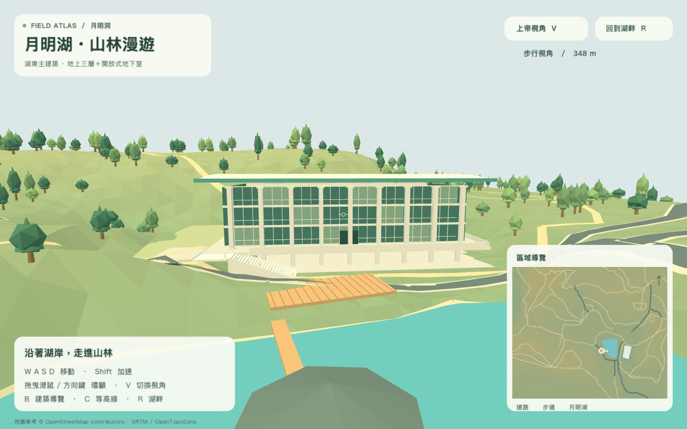

# wdm_map

以月明湖地形參考圖製作的 Q 版 3D 地圖，使用 GDevelop 5。支援第一人稱漫遊與上帝視角，地形、建築、道路和樹木均已放入原生場景，可直接選取、移動、旋轉與縮放。



## 開啟專案

1. 安裝 GDevelop 5；目前專案以 **5.6.287** 驗證。
2. 下載或 clone 整個儲存庫。
3. 在 GDevelop 選擇「開啟 → 您的電腦」，開啟 [`yue-ming-terrain/editable-map.json`](yue-ming-terrain/editable-map.json)。
4. 開啟「月明湖地形」場景。右側資料夾提供地形、建築、湖岸、道路、步道及樹木；按「預覽」即可漫遊。

`native-assets` 必須與專案一起保留。直接開啟與預覽不需要 MCP、Node.js 或 Python。

## 操作與編輯

| 操作 | 功能 |
| --- | --- |
| WASD | 第一人稱移動／上帝視角平移 |
| Shift | 加速行走 |
| 拖曳滑鼠／方向鍵 | 環顧／環繞 |
| V | 切換第一人稱與上帝視角 |
| 滾輪／Q、E | 上帝視角縮放 |
| C | 切換等高線 |
| B／R | 回到湖畔建築觀賞點 |

編輯器中，物件選單的「選取場景中的實例」可找到已放置的模型，再按 **F** 對焦。左側屬性面板可修改座標、尺寸與角度。

湖東主建築分成 `Hall_Main` 主體、`Hall_Basement` 地下室、`Hall_Platform` 平台、`Hall_Stairs` 白色樓梯及 `Hall_Terrace` 高地平台。整棟搬移時請一起選取相關部分。

模型位置與尺寸可直接編輯；山形、道路曲線與建築網格細節需要更新對應的 GLB 模型。行走高度與碰撞讀取實際場景模型，預覽不會重新生成並覆蓋手動擺放的物件。

## 地圖擴充

- 座標單位為公尺：X 向東、Y 向南、Z 向上；海拔基準為 240 m。
- 目前範圍為 X=0…576、Y=0…490，四塊地形約各 288 × 245 m。
- 保留現有座標，向外新增地形即可；向北或向西擴充可以使用負座標。
- 新地形物件名稱使用 `Terrain_` 前綴，放在 `Terrain3D` 圖層；`Terrain_Cutaway` 為底座，不計入行走邊界。
- 鏡頭邊界會依場景地形範圍擴大。新增真實區域仍需對應地圖／高程資料，並處理區塊接縫及更新導覽圖。

## 資料與工具

| 路徑 | 內容 |
| --- | --- |
| `yue-ming-terrain/editable-map.json` | 可直接開啟的 GDevelop 專案，57 種物件、1,204 個實例 |
| `yue-ming-terrain/native-assets/` | 57 個 GLB 模型 |
| `yue-ming-terrain/terrain-data.json` | 高度網格、湖岸、道路及步道 |
| `yue-ming-terrain/building-data.json` | 建築尺寸、朝向、樓梯及平台設定 |
| `yue-ming-terrain/native-manifest.json` | 轉換時的資產與實例配置 |
| `yue-ming-terrain/native-runtime.js` | 鏡頭、輸入、行走與導覽介面程式 |
| `yue-ming-terrain/native-test.js` | 原生場景的預覽驗證腳本 |

`terrain-runtime.js` 保留程序式模型的來源；`export-native.cjs` 將其轉成 GLB，`build-native.py` 產生初始原生專案。這些是重建工具，重新執行會覆寫初始資產或專案；請先備份手動編輯結果。匯出工具使用本機 GDevelop 安裝附帶的 Three.js，需要 Node.js；專案產生器需要 Python 3。

`reconstruct.py` 可從原始地形參考圖片推估高程，需要 Pillow、NumPy、SciPy：

```sh
python yue-ming-terrain/reconstruct.py /path/to/reference-map.jpg
```

原始參考照片與地形圖片不包含在儲存庫中。已驗證模型載入、樓梯與平台連通、立面碰撞、雙視角及向東新增區塊後的鏡頭範圍，共 27 項檢查通過；結果保存在 `native-preview-test-result.json`。

## 地景精度與來源

高程依參考圖片色階近似重建，非實測 DEM。道路依圖片描繪；建築依提供的照片簡化，為地上三層與一層開放地下室，左側白色樓梯銜接一樓平台及較高平地。樓層高度、植栽與部分景觀設施為示意。

地形參考圖標示來源：© OpenStreetMap contributors · SRTM / OpenTopoData。
