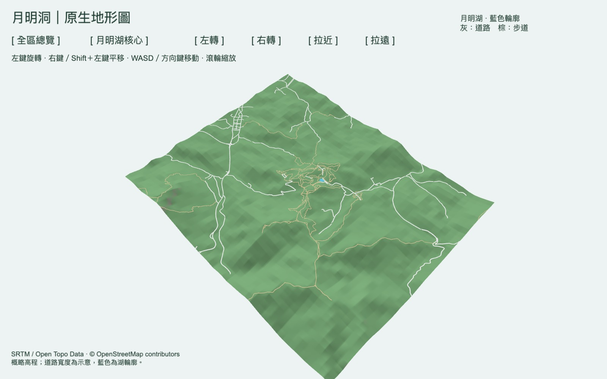

# 月明洞｜原生地形圖

使用 GDevelop 5 製作的可旋轉地形圖。地形是 **Terrain3D 原生物件**，可以在編輯器中雕刻高低、平整地面與塗色。目前包含山勢、道路／步道、月明湖輪廓、地圖視角及第一人稱步行。

## 開啟與操作

在 GDevelop 選擇「開啟 → 您的電腦」，開啟 **`wolmyeongdong/project.json`**，再開啟「月明洞地形圖」場景，按「預覽」。更新後請關閉舊預覽再重新啟動。整個儲存庫須一起保留；開啟與預覽不需要 Python、Node.js 或 MCP。

| 操作 | 功能 |
| --- | --- |
| 左鍵拖曳地圖 | 旋轉與調整俯視角度 |
| 右鍵或左 Shift＋左鍵拖曳地圖 | 平移 |
| 滾輪 | 地圖模式縮放，最近距離 5 公尺 |
| 方向鍵或 WASD | 上下左右平移 |
| J／L | 左右旋轉 |
| I／K | 調整俯視角度 |
| Q／E | 拉遠／拉近 |
| F／「第一人稱」按鈕 | 從目前地圖中心進入步行；再次按 F 回到地圖 |
| Home | 離開步行，回到全區總覽 |
| 畫面上的文字按鈕 | 全區／月明湖核心切換、旋轉、縮放 |

預覽採用 2560 × 1600 繪製；介面文字也以相同解析度繪製。鏡頭平移時會依地形調整中心高度。

## 第一人稱步行

建議先按「月明湖核心」，再按 **F** 或「第一人稱」。會從目前地圖中心進入，並鎖定滑鼠以轉頭。

- **WASD／方向鍵**：依面向前進、後退、左右側移。
- **滑鼠**：左右轉頭、抬頭與低頭。
- **Shift**：加速；一般每秒約 1.8 公尺，加速約 4 公尺。
- **Esc**：放開滑鼠，方便點選介面；再點一下地面恢復滑鼠轉頭。
- **J／L、I／K**：也能用鍵盤左右轉頭、抬頭低頭。
- **F**：回到目前位置上方的地圖視角；**Home** 回全區。

鏡頭以地形高度加 1.7 公尺跟隨地面；斜向移動不會加速。月明湖按已保存的湖岸輪廓阻擋進入，地圖邊緣也有邊界。目前是概略地形漫遊，不包含跳躍、重力、真實陡坡攀爬限制或建築碰撞。

道路及湖輪廓在步行模式減少顯示間距，避免示意圖層浮到視線上方；回地圖時恢復原間距。此顯示調整不代表量測水面高度。

## 在編輯器修改地形

1. 切換場景上方的 **3D** 按鈕。
2. 展開「01 地形｜可雕刻與塗色」，在 `WolmyeongTerrain` 右鍵選「選取場景中的實例」，按 F 對焦。
3. 使用地形上方的筆刷：抬高、降低、平滑、平整，以及四個塗色按鈕。再按一次啟用的筆刷可以離開筆刷模式。
4. 四層用途為：**1 草地、2 岩石、3 道路、4 步道**。筆刷上的通用層名稱可能仍顯示 dirt／rock／sand，請依顏色與這個對應操作。
5. 完成後按編輯器工具列的「儲存專案」。修改保存在地形物件的 **SculptData**；重新開啟和預覽不會自動重建或覆蓋它。

可先使用較小的筆刷與較低強度，逐次修改。`HeightmapImage` 是初始高程，`Edits` 是初始路網塗繪；手動修改使用 `SculptData`。清空 SculptData 會回到高度圖加初始路網，請只在需要重置地形時操作。

道路與步道另加 `RoadDetail`／`TrailDetail` 貼地線條，避免原生塗色的柔邊在拉近後變糊。原生塗色仍保留為淡色底稿，四層筆刷都能繼續使用。線條是靜態示意模型：若修改路線或雕刻其下方地形，需同步重產線條，或暫時隱藏這兩個物件；筆刷不會改寫模型。

地面使用每 8 公尺重複的細節材質，配合 16 倍非等向過濾。這是視覺示意，不是現場地表照片。

月明湖是獨立的 `MoonLake` 輪廓示意物件。它依初始地形貼地，預留少量顯示間距避免閃爍；若日後大幅雕刻湖區，需要同步調整或重產此輪廓。

## 地理資料與精度

- 範圍：西 127.3454°、東 127.3850°、南 36.1050°、北 36.1446°，約 **3.56 × 4.40 公里**。
- X 向東、Y 向南、Z 向上；一個場景單位對應一公尺。原點是西北角；**海拔 = 場景 Z + 150 公尺**，高低差倍率為 1。
- 周邊 2,025 點，另保留核心區 1,681 點（部分重疊）；核心邊界以約 100 公尺過渡帶銜接。
- 初始高度圖為 513 × 513 RGB PNG，R/G 儲存 16 位元高度；地形解析度為每邊 1024 格，改善拉近後道路塗色模糊的問題。高度圖仍為 513 × 513；提高地形與塗色格數不增加原始海拔資料精度。
- 道路與步道來自 OpenStreetMap，共 243 個道路物件，轉成 1,683 段原生塗繪。清晰線條的道路寬約 12 公尺、步道約 6 公尺，均為可讀性示意；原始線形仍保留在 `source-data/roads.geojson`。
- 湖輪廓來自 OSM。藍色物件不表示實測湖面海拔或湖深。
- 珍山國小舊校區、下方停車場、陽光草皮、316 會館與山頭名稱仍待圈選核對，沒有擅自新增位置。

來源：[Open Topo Data / SRTM](https://www.opentopodata.org/datasets/srtm/)、[USGS SRTM](https://www.usgs.gov/centers/eros/science/usgs-eros-archive-digital-elevation-shuttle-radar-topography-mission-srtm)、[© OpenStreetMap contributors / ODbL](https://www.openstreetmap.org/copyright)。原始資料、來源與待確認清單均在 `source-data/`。

## 檔案與重建

| 位置 | 用途 |
| --- | --- |
| `wolmyeongdong/project.json` | 原生 GDevelop 專案；地形、湖與介面均可在編輯器選取 |
| `wolmyeongdong/assets/` | 高度圖、湖輪廓模型、初始塗繪與座標設定 |
| `source-data/` | 已保存的公開地理資料，不依賴其他資料夾或線上 API |
| `tools/build_assets.py` | 用原始資料重產初始資產；不改寫專案、事件或 SculptData |
| `tools/build_map_detail.py` | 產生重複細節材質與貼地路線；不改寫地形筆刷資料 |
| `tools/camera.events.txt` | 原生鏡頭事件的可讀來源；專案內已有編譯後的事件 |
| `validation/` | 轉換檢查、GDevelop 預覽測試與圖片 |

資產生成工具需要 Python 3 與 Pillow。日常編輯請直接使用 GDevelop；有手動修改時，不必重新執行生成工具。

本版已移除舊的 `yue-ming-terrain/` 成品，已加入第一人稱，尚未放入建築、亭子或植栽。GDevelop 地形擴充本身包含 JavaScript 實作，但場景鏡頭與輸入使用原生事件，沒有執行時重新生成整張地圖的程式。
